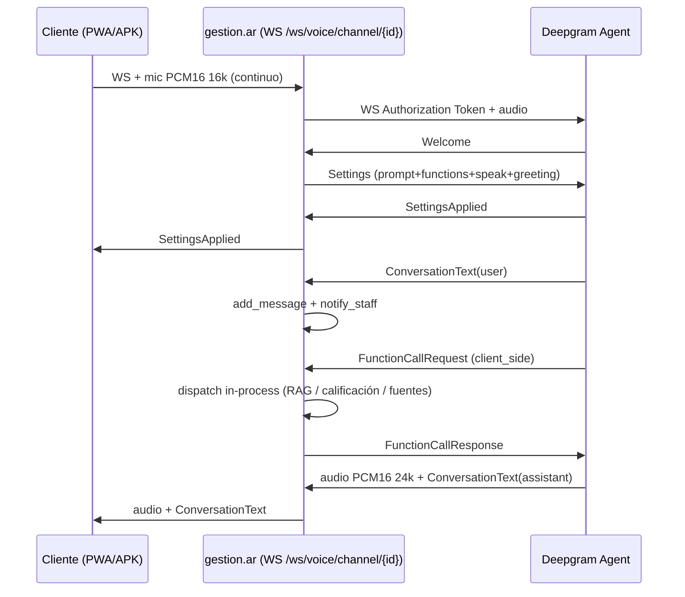

# Canal de voz Deepgram en gestion.ar (PWA + APK)

## Contexto

Se quiere un canal de **voz** que conviva con el chat de WhatsApp ya implementado, con dos
superficies: el chat web/PWA propio (`/chat/c/:channelId`) y la app Android existente
`~/workspace/deepgram_chat` (Rust + Dioxus 0.7, hoy apuntada al demo
`~/Investigando/fastapi-voice-agent`). El resultado esperado es un prototipo funcional de
punta a punta: el cliente habla, Deepgram transcribe/razona/sintetiza, el agente de voz usa el
prompt del bot, sus tools y su RAG de gestion.ar, y cada turno queda en `conversations`/
`messages` y en la bandeja de staff.

**Decisión de arquitectura:** gestion.ar actúa de **proxy WebSocket server-side** hacia
`wss://agent.deepgram.com/v1/agent/converse`. La API key de Deepgram nunca sale del backend; el
`Settings` (prompt, tools, LLM, voz) lo construye el backend, no el cliente; las
`FunctionCallRequest` se ejecutan **en el mismo proceso** que sostiene el socket (client-side
functions sin `endpoint`), así el estado de sesión y el dispatcher de tools existente se
reutilizan sin endpoints HTTP públicos y sin depender del worker.

**El canal de WhatsApp queda intacto.** El cambio es aditivo: se agrega un valor nuevo a los
enums (`ChannelType.VOICE`, `ClientSource.VOICE`) y una columna nullable
(`channels.voice_config`). No se modifica ningún archivo de WhatsApp ni su contrato:
`app/routers/whatsapp_webhook_router.py`, `app/whatsapp_service.py`,
`app/providers/meta_provider.py`, `app/providers/twilio_provider.py`, las clases
`WhatsAppConfig`/`MetaWhatsAppConfig`/`TwilioWhatsAppConfig`, los valores
`ChannelType.WHATSAPP`/`WhatsAppProvider.*`, las rutas `/api/webhook/whatsapp/*` ni las
variables de entorno de Meta/Twilio.

**El cliente principal del canal nuevo es la app Rust**: `~/workspace/deepgram_chat`
(Dioxus 0.7) se compila con `dx` a un **APK Android** instalable (y a `.aab` para Play). La PWA
recibe el mismo modo voz porque comparte el protocolo del proxy, no porque reemplace al APK.

Consecuencia explícita del alcance: el turno lo decide el LLM de Deepgram, así que **no corren
los interceptores pre-LLM** de los módulos (embudo de leads `flow`, mini-conversación de
reserva de turnos) ni los widgets. El canal de voz usa solo contribuciones sin estado: tool de
calificación por semáforo, fuentes públicas y RAG. `BotConfig.flow.enabled` no tiene efecto en voz.



## Approach

### 1. Modelo de canal de voz (sin cambio de comportamiento todavía)

Cambios puramente aditivos: `whatsapp`, `telegram`, `web` y `pwa` siguen funcionando igual y
ninguno de sus modelos, configs, webhooks o validaciones se modifica.

- `backend/app/models/channel.py`
  - `ChannelType`: agregar `VOICE = "voice"`.
  - Nueva clase, antes de `ChannelBase`:
    ```python
    class VoiceConfig(BaseModel):
        listen_model: str = Field(default="nova-3", description="Modelo STT de Deepgram")
        language: str = Field(default="es", description="Idioma de escucha")
        voice_model: str = Field(default="aura-2-celeste-es", description="Voz Aura-2 en español")
    ```
  - Agregar `voice_config: Optional[VoiceConfig] = None` a `ChannelCreate`, `ChannelUpdate` y
    `Channel`.
- `backend/app/models/client.py`: `ClientSource.VOICE = "voice"` (hoy un source desconocido
  cae a `MANUAL` en `ClientService.get_or_create_client`).
- `backend/app/db/models.py` (`class Channel`): `voice_config = Column(JSONB, nullable=True)`
  después de `pwa_config`.
- `backend/app/services/channel_service.py`
  - `_to_channel`: `voice_config=row.voice_config`.
  - `create_channel`: `voice_config=channel_data.voice_config.model_dump() if channel_data.voice_config else None`.
  - `_generate_webhook_url`: rama nueva
    ```python
    elif channel_type == ChannelType.VOICE:
        ws_base = base_url.replace("https://", "wss://").replace("http://", "ws://")
        return f"{ws_base}/ws/voice/channel/{channel_id}"
    ```
- Migración `backend/alembic/versions/20261028_1200_add_channel_voice_config.py`:
  `revision = 'c3f8a2b6d741'`, `down_revision = 'b2e7f4a91c05'` (head actual: `add_reclamos`).
  `upgrade`: `op.add_column('channels', sa.Column('voice_config', postgresql.JSONB(), nullable=True))`;
  `downgrade`: `op.drop_column('channels', 'voice_config')`.
- `backend/app/routers/channel_router.py`: sin cambios de validación (solo WhatsApp y Telegram
  exigen config). Actualizar el docstring del `POST` (“whatsapp, telegram, web, pwa o voice”).

### 2. Servicio de sesión de voz

Archivo nuevo `backend/app/services/voice_session_service.py`.

Constantes y errores:

```python
DEEPGRAM_WS_URL = "wss://agent.deepgram.com/v1/agent/converse"
MANAGED_PROMPT_LIMIT = 25_000          # chars, límite de Deepgram con LLM gestionado
DEFAULT_MANAGED_LLM = "gpt-4o-mini"
RAG_TOOL_NAME = "buscar_conocimiento"
DEFER_UNTIL_EOT = {QUALIFICATION_TOOL_NAME}   # escribe en la DB

class VoiceConfigError(RuntimeError):
    """Configuración de voz inválida (falta key o prompt demasiado largo)."""

VOICE_STYLE_SUFFIX = (
    "\n\nEstás en una conversación de VOZ: responde en una o dos frases cortas, "
    "en el mismo idioma del usuario, sin markdown, sin listas ni emojis, y sin leer "
    "URLs en voz alta (decí que el enlace está en el chat)."
)
```

- `def build_voice_prompt(bot) -> str` → `build_effective_system_prompt(bot.config) + VOICE_STYLE_SUFFIX`.
- `def build_think(bot) -> dict` — `VOICE_THINK` (env, default `auto`) elige:
  - `auto` → mapea `LLM_PROVIDER` (`claude`/`deepseek`/`ollama`); `ollama` y desconocidos →
    gestionado.
  - `deepseek`:
    ```python
    key = os.getenv("DEEPSEEK_API_KEY")
    if not key: raise VoiceConfigError("DEEPSEEK_API_KEY no configurada para voz")
    return {"provider": {"type": "open_ai", "model": os.getenv("DEEPSEEK_MODEL", "deepseek-v4-flash")},
            "endpoint": {"url": f"{os.getenv('DEEPSEEK_BASE_URL','https://api.deepseek.com').rstrip('/')}/chat/completions",
                         "headers": {"authorization": f"Bearer {key}"}}}
    ```
  - `claude`:
    ```python
    key = os.getenv("CLAUDE_API_KEY") or os.getenv("ANTHROPIC_API_KEY")
    if not key: raise VoiceConfigError("CLAUDE_API_KEY no configurada para voz")
    return {"provider": {"type": "anthropic", "model": os.getenv("CLAUDE_MODEL", "claude-sonnet-4-5")},
            "endpoint": {"url": "https://api.anthropic.com/v1/messages",
                         "headers": {"x-api-key": key, "anthropic-version": "2023-06-01"}}}
    ```
  - `managed` (y fallback de `auto`): `{"provider": {"type": "open_ai", "model": os.getenv("VOICE_FALLBACK_LLM", DEFAULT_MANAGED_LLM)}}`.
  - Un `think` sin `endpoint` es "gestionado": el prompt queda sujeto a `MANAGED_PROMPT_LIMIT`.
- `def build_voice_settings(bot, channel, history: list[dict]) -> dict`
  - `voice = channel.voice_config or VoiceConfig()`; `prompt = build_voice_prompt(bot)`;
    `think = build_think(bot)`.
  - Si `"endpoint" not in think and len(prompt) > MANAGED_PROMPT_LIMIT`:
    `raise VoiceConfigError(f"El prompt del bot ({len(prompt)} chars) supera el límite gestionado; configurá VOICE_THINK=claude|deepseek")`.
  - Devuelve:
    ```python
    {"type": "Settings",
     "audio": {"input": {"encoding": "linear16", "sample_rate": 16000},
               "output": {"encoding": "linear16", "sample_rate": 24000, "container": "none"}},
     "agent": {
       "greeting": get_effective_welcome_message(bot.config),
       "context": {"messages": history} if history else {},
       "listen": {"provider": {"type": "deepgram", "model": voice.listen_model,
                               "language": voice.language, "smart_format": True}},
       "think": {**think, "prompt": prompt, "functions": functions},
       "speak": {"provider": {"type": "deepgram", "model": voice.voice_model}},
     }}
    ```
    (las `functions` las pasa el caller; ver abajo → `build_voice_settings(bot, channel, history, functions)`).
- `async def build_voice_functions(bot, client, client_id) -> tuple[list[dict], Callable[[str, dict], dict]]`
  - Base: `tools, dispatch = await get_agent_service().build_tools(bot, client, client_id, "voice", None, [])`
    (`session=None` ⇒ solo contribuciones sin estado: calificación + fuentes públicas).
  - Si `bot and bot.config.use_rag`: agregar tool RAG y su executor:
    ```python
    rag_spec = {"name": RAG_TOOL_NAME,
                "description": "Busca en la base de conocimiento del negocio (documentos, normas, "
                               "precios, requisitos). Llamala antes de responder preguntas factuales.",
                "parameters": {"type": "object",
                               "properties": {"consulta": {"type": "string", "description": "Búsqueda"}},
                               "required": ["consulta"]}}
    def _rag(_name, args):
        ctx = get_rag_service().get_context(args.get("consulta",""), bot_id=bot.bot_id,
                                            n_results=bot.config.rag_results_count)
        return {"resultado": ctx} if ctx else {"resultado": "No hay información cargada sobre eso."}
    ```
  - Si no hay tools, devolver `([], lambda _n, _a: {"error": "Tool desconocida"})`.
  - Wire format: para cada spec `{"name","description","parameters"}` agregar
    `"defer_until_eot": name in DEFER_UNTIL_EOT`; validar `re.fullmatch(r"[A-Za-z0-9_-]{1,64}", name)`
    (raise `VoiceConfigError` si no cumple).
  - `dispatch` combinado: el de `build_tools` + el RAG; devolver la función y un
    `async def execute(name, args) -> str` que hace `json.dumps(await asyncio.to_thread(fn, name, args), ensure_ascii=False)`.
- `def history_messages(conv: Optional[dict], limit: int = 20) -> list[dict]` →
  `[{"type": "History", "role": m["role"], "content": m["content"]} for m in conv["messages"][-limit:]]`
  (`ConversationService.get_latest_conversation_by_user` ya devuelve `messages`).

### 3. Router WS y puente

Archivo nuevo `backend/app/routers/voice_router.py` (sin `prefix` para que convivan HTTP y WS, igual
que `web_chat_router`). Registrar en `backend/app/main.py` junto a `web_chat_router`.

`@router.get("/api/voice/channels/{channel_id}/config")` (público):
- 404 si no existe; 403 si `status != active`; 400 si `channel_type != voice`.
- Respuesta: `{"channel_id", "channel_type", "bot": {"bot_id", "name"}, "voice_model",
  "greeting", "ws_path": f"/ws/voice/channel/{channel_id}"}`.

`@router.websocket("/ws/voice/channel/{channel_id}")` con `device_id: Optional[str] = Query(None)`:
1. `accept()`; resolver canal (404→`send_json({"type":"error","message":"Canal no encontrado"})` + `close(4004)`;
   tipo distinto → 4004; `status != active` → `close(4403)`), bot y tenant.
2. `device_id = device_id or str(uuid.uuid4())`;
   `client = await get_client_service().get_or_create_client(bot_id=bot.bot_id, external_id=device_id, source="voice", channel_id=channel_id)`;
   `conversation_id = await get_conversation_service().create_conversation(user_id=device_id, bot_id=bot.bot_id, client_id=client.client_id, channel="voice", metadata={"source": "voice", "channel_id": channel_id, "device_id": device_id})`.
3. Historial: `history_messages(await conv_service.get_latest_conversation_by_user(device_id, bot.bot_id, channel_id))`
   calculado **antes** de crear la conversación nueva (si no, se lee a sí misma).
4. `functions, execute = await build_voice_functions(bot, client, client.client_id)`;
   `try: settings = build_voice_settings(bot, channel, history, functions)`; en
   `VoiceConfigError` → `send_json({"type":"error","message":str(e)})` + `close(1011)` y return.
   Si falta `DEEPGRAM_API_KEY` → mismo tratamiento con mensaje `"Falta DEEPGRAM_API_KEY en el servidor"`.
5. `send_json({"type":"meta","conversation_id":..., "bot_name":bot.name, "tenant_name":tenant.name, "greeting": get_effective_welcome_message(bot.config)})`.
6. `async with websockets.connect(DEEPGRAM_WS_URL, additional_headers={"Authorization": f"Token {api_key}"}, max_size=None) as dg:` y dos tareas:
   - **DG → cliente** (`while`): `bytes` → `websocket.send_bytes`; `str`:
     - `Welcome` → `dg.send(json.dumps(settings))`; **no** reenviar.
     - `FunctionCallRequest` → por cada `f` en `msg["functions"]` con `f.get("client_side")`:
       `args = json.loads(f.get("arguments") or "{}")` (si falla, `{}`), `content = await execute(f["name"], args)`,
       `dg.send(json.dumps({"type":"FunctionCallResponse","id":f["id"],"name":f["name"],"content":content}))`.
       No reenviar. `FunctionCallCancelled` → ignorar.
     - `ConversationText` → `role = msg["role"]`, `content = msg["content"]`:
       - `user` → `conv_service.add_message(conversation_id, "user", content, {"source":"voice"})`,
         `notify_staff_of_client_message(bot_id=..., conversation_id=..., client_id=client.client_id,
         client_label=client.name or device_id[:8], content=content, channel="voice")`,
         `client_service.increment_counters(client.client_id, messages=1)`.
       - `assistant` → `cost = (monotonic() - last_t) * VOICE_COST_PER_MINUTE_USD / 60`;
         `add_message(conversation_id, "assistant", content, {"source":"voice","estimated_cost_usd": cost,"model":think_model})`.
       - Reenviar tal cual al cliente.
     - `Error`/`Warning` → `logger.warning` con `code` + `description`; reenviar.
     - Resto (`SettingsApplied`, `UserStartedSpeaking`, `AgentThinking`, `AgentStartedSpeaking`,
       `AgentAudioDone`, `LatencyReport`) → reenviar tal cual.
   - **Cliente → DG**: `bytes` → `dg.send(bytes)`; `str`:
     - `{"type":"text","content":...}` → `dg.send({"type":"InjectUserMessage","content":...})`.
     - `Settings` / `UpdateThink` / `UpdatePrompt` / `UpdateSpeak` → **ignorar** (el servidor es dueño de la config).
     - Resto → reenviar.
7. `finally`: cancelar la tarea de reenvío, cerrar `dg`, `websocket.close()` en el `except`; log del error con
   `traceback.format_exc()` (nunca `str(exc)` de un cliente HTTP con headers).

Env nuevas (leer con `os.getenv`, sin defaults secretos):
`DEEPGRAM_API_KEY` (requerida), `VOICE_FALLBACK_LLM` (default `gpt-4o-mini`),
`VOICE_COST_PER_MINUTE_USD` (default `0.075`), `VOICE_THINK` (`auto` default).

`backend/requirements.txt`: agregar `websockets==12.0` (uvicorn 0.27 lo acepta y ya lo trae
transitivamente; fijarlo evita que un rebuild suba a una major con API distinta).

### 4. Acceso desde el panel

- **Sin QR para `voice` todavía**: el QR codifica `/chat/c/{channel_id}`, y la UI de voz de la
  PWA no está implementada en esta iteración. El `get_public_qr_code` y `get_channel_qr_code`
  siguen limitados a `web`/`pwa`; el canal de voz muestra su WebSocket URL en la tarjeta y el
  APK entra con la API key del tenant.
- `frontend/src/types/channel.types.ts`: `ChannelType` suma `'voice'`; nueva
  `export interface VoiceConfig { listen_model?: string; language?: string; voice_model?: string }`;
  `Channel`, `ChannelCreate` y `ChannelUpdate` suman `voice_config?: VoiceConfig`.
- `frontend/src/pages/BotChannels.tsx`
  - `<option value="voice">Voz (Deepgram)</option>` en el select de tipo.
  - Bloque informativo cuando `formData.channel_type === 'voice'`: “No requiere configuración;
    el APK se conecta con la API key del tenant”.
  - `CreateChannelForm` gana `voice_config?: VoiceConfig` (default `{}`), y `handleCreate` agrega
    `...(formData.channel_type === 'voice' ? { voice_config: formData.voice_config ?? {} } : {})`.
  - `isVoiceChannel` junto a `isWebChannel`/`isPwaChannel` para la etiqueta “WebSocket URL:” y
    ocultar la edición de webhook; el botón de QR sigue sólo en `web`/`pwa`.
- `frontend/src/components/channels/ChannelEditForm.tsx`: si `channel.channel_type === 'voice'`,
  select de `voice_model` con `aura-2-celeste-es` (default), `aura-2-estrella-es`,
  `aura-2-nestor-es`, `aura-2-sirio-es`; `listen_model` fijo `nova-3` y `language` `es` (solo lectura).
  Enviar `updateData.voice_config` en el submit.

### 5. Cliente PWA (chat web)

- `frontend/src/lib/chatWsUrl.ts` (nuevo): mover la lógica de `buildWsUrl` de
  `useWebSocketChat.ts` a `export function buildChatWsUrl(path: string, deviceId: string): string`
  (misma derivación http→ws / `window.location`). `useWebSocketChat` lo usa con
  `/ws/chat/{id}?device_id=...` o `/ws/chat/channel/{id}?device_id=...`.
- `frontend/src/hooks/useChannelInfo.ts`: `publicService.getChannelInfo(channelId)` (ya existe) y
  tipar `PublicChannelInfo` con `channel_type: ChannelType`.
- `frontend/src/components/chat/ChatInterface.tsx`: extraer el cuerpo actual a
  `TextChatInterface` (mismo archivo, componente interno) y convertirlo en selector:
  ```tsx
  if (channelId && info?.channel_type === 'voice') return <VoiceChatInterface channelId={channelId} />;
  return <TextChatInterface botId={botId} channelId={channelId} />;
  ```
  Mientras `info` carga sin `channelId`, renderizar `TextChatInterface` (comportamiento actual).
- `frontend/src/lib/voiceAudio.ts` (nuevo): captura y reproducción PCM.
  - `startMic(onChunk: (b64: string) => void): Promise<{ stop(): void }>`: `getUserMedia` con
    `echoCancellation/noiseSuppression/autoGainControl`, `AudioContext({sampleRate: 16000})`,
    `ScriptProcessorNode(2048)`, cola con tope de 5 s y **remuestreo con fase fraccional** a 16 kHz
    por bloque de 100 ms (código `CONV_START`/`CONV_DRAIN` de
    `~/workspace/deepgram_chat/src/main.rs`, portado a TS).
  - `playPcm24k(b64: string)`, `stopPlayback()`, `mutePlayback(bool)`: `AudioContext` único,
    `AudioBuffer` de 24000 Hz, colchón de 150 ms encadenando `start(t)` (código `AUDIO_JS`).
- `frontend/src/hooks/useVoiceChat.ts` (nuevo):
  ```ts
  type VoiceStatus = 'conectando' | 'listo' | 'escuchando' | 'pensando' | 'hablando' | 'sin-microfono' | 'error';
  export function useVoiceChat(channelId: string): {
    messages: ChatMessage[]; status: VoiceStatus; error: string | null;
    connected: boolean; micActive: boolean;
    startMic(): Promise<void>; stopMic(): void; interrupt(): void; sendText(content: string): void;
  }
  ```
  - WS a `buildChatWsUrl('/ws/voice/channel/' + channelId + '?device_id=' + getOrCreateDeviceId(), deviceId)`,
    `binaryType='arraybuffer'`; reconexión con espera de 1.5 s mientras el componente esté montado.
  - `onmessage`: `string` → `JSON.parse`: `meta` (bot_name/tenant_name), `ConversationText` →
    agregar burbuja (`user`/`assistant`), `UserStartedSpeaking` → `stopPlayback()` + `mutePlayback(true)`,
    `AgentThinking` → `pensando`, `AgentStartedSpeaking` → `hablando`, `AgentAudioDone` → `escuchando`
    + `mutePlayback(false)`, `SettingsApplied` → `listo`, `Error`/`Warning` → `error`.
    `ArrayBuffer` → `playPcm24k(base64)`.
  - `startMic` sólo tras `SettingsApplied`; `stopMic` cierra el stream y el `AudioContext` de entrada.
    Si `getUserMedia` falla → `status='sin-microfono'` y mensaje “revisá el permiso”.
  - `interrupt()` = `stopPlayback()` + `mutePlayback(true)` (barge-in local; no se envía frame a Deepgram).
  - `sendText` → `ws.send(JSON.stringify({type:'text', content}))`.
- `frontend/src/components/chat/VoiceChatInterface.tsx` (nuevo): `ChatHeader` + lista de burbujas
  (mismos estilos de `TextChatInterface`) + barra inferior con botón redondo de micrófono (pulso
  cuando `micActive`), subtítulo de estado en español (`te escucho…`, `pensando…`, `hablando…`,
  `sin micrófono`), botón **Interrumpir** habilitado sólo en `hablando`, y un input de texto
  colapsable (“Escribir”) para cuando no hay micrófono. Sin widgets de turnos.

### 6. Cliente APK Android con Dioxus (`~/workspace/deepgram_chat`)

Objetivo: la app Rust deja de hablar con Deepgram directamente y pasa a ser un cliente fino del
proxy de gestion.ar. Sin key de Deepgram, sin selector de LLM, sin catálogo de plugins local.
Sigue siendo una app Dioxus 0.7: el mismo proyecto produce el APK Android con `dx`.

- `.env`: `BACKEND_URL=https://<host-de-gestion.ar>` y `TENANT_KEY=tk_live_…` (opcional; si
  falta, la app la pide en ⚙️ y la guarda en `localStorage`).
- `build.rs`: además de `DEEPGRAM_BACKEND_URL`, emitir
  `cargo:rustc-env=DEEPGRAM_TENANT_KEY=<valor>` (mismo parser; default vacío).
- `src/config.rs`: `backend_url()`, `tenant_key()`, `session_url()` y
  `ws_url(ws_path, ticket, device_id)` (`http→ws`/`https→wss` sobre `backend_url()`).
  Los valores de build se pueden sobrescribir en escritorio con un `.env` de runtime
  (directorio actual o carpeta de datos).
- `src/agent.rs`
  - `pub async fn conectar(url: &str) -> Result<Agente, String>`: conectar sin header
    `Authorization` y **sin** enviar `Settings` (se espera `SettingsApplied` que reenvía el proxy).
  - Sin `Proveedor`, `AjustesLlm`, `configuracion`, `think`, `RESPALDO_MODELO`, `Turn` ni
    `FunctionCallRequest`/`responder_funcion` (las tools corren en el proxy).
  - `AgentEvent::Meta { bot_name, tenant_name, greeting }` para la identidad que resolvió la key.
  - Mantener: `SettingsApplied`, `ConversationText`, `UserStartedSpeaking`, `AgentThinking`,
    `AgentStartedSpeaking`, `AgentAudioDone`, `Error`, `Warning`, audio binario, reconexión.
- `src/plugins/{mod.rs,plugins.json}` y `src/deepgram.rs`: **borrados**. `main.rs` queda con un
  único `ContactRow` cuyo nombre/iniciales salen de `bot_name` (`meta`).
- `src/main.rs`: el modal ⚙️ sólo pide la **API key del tenant** y persiste `tenant_key`; el
  `device_id` (UUID) se genera en el webview y se guarda en `localStorage`. `start_agent` hace
  `POST /api/public/voice/session` (Bearer key) y conecta el `ws_path` con el `ticket`.
  Mantener el layout de dos paneles, la captura de micrófono
  (`AUDIO_JS`/`CONV_START`/`CONV_DRAIN`) y la reproducción tal cual.
- `Dioxus.toml`: no tocar `[permissions.microphone]` ni `[android.permissions]` (el diálogo de
  micrófono y `MODIFY_AUDIO_SETTINGS` ya están verificados en el APK actual). El `identifier`
  sigue siendo el del proyecto; un despliegue por tenant cambia `TENANT_KEY` en `.env` o la key
  ingresada en Configuración.
- Distribución del APK (comandos exactos, ya probados en este proyecto):
  - Sideload/QA: `JAVA_HOME=/usr/lib/jvm/java-21-openjdk dx build --platform android --target aarch64-linux-android`
    deja el APK debug firmado con la clave de depuración en
    `$CARGO_TARGET_DIR/dx/deepgram-chat/debug/android/app/app/build/outputs/apk/debug/app-debug.apk`.
  - Play Store: `JAVA_HOME=/usr/lib/jvm/java-21-openjdk dx bundle --platform android` genera un
    `.aab` **sin firmar** (lo firma Play); no se instala con `adb install`.
  - El APK acumula ABIs si se compiló antes para otro target: borrar
    `.../app/src/main/jniLibs/x86_64` antes de empaquetar para arm64 (no hay `dx clean`).
- `README.md`: reescribir la sección de uso (sin API key; `BACKEND_URL` + `TENANT_KEY`; el
  agente lo configura gestion.ar), documentar el build del APK y quitar la tabla de proveedores LLM.

### 7. Documentación obligatoria (AGENTS.md)

- `docs/dev/API.md`: `GET /api/voice/channels/{id}/config` y `WS /ws/voice/channel/{id}` con la
  tabla de frames cliente→servidor y servidor→cliente.
- `docs/dev/DATA_MODEL.md`: `channels.voice_config`, `channel_type=voice`, `clients.source=voice`,
  `conversations.channel='voice'`.
- `docs/dev/DECISIONS.md`: **ADR-034 — Canal de voz con Deepgram Voice Agent detrás de un proxy
  server-side**: key y `Settings` en el backend; functions client-side ejecutadas en el proceso
  del socket; sin interceptores pre-LLM; costo por minuto; 45 conexiones concurrentes PAYG.
- `docs/dev/SETUP.md`: cómo crear el canal, `DEEPGRAM_API_KEY`, desarrollo con micrófono
  (HTTPS o `localhost`) y `adb reverse` para el APK.
- `docs/ops/INFRASTRUCTURE.md`: egress a `agent.deepgram.com`, límite de 45 conexiones, costo.
- `ENV.md` + `.env.example`: `DEEPGRAM_API_KEY`, `VOICE_THINK`, `VOICE_FALLBACK_LLM`,
  `VOICE_COST_PER_MINUTE_USD`.
- `CHANGELOG.md`: entrada del canal de voz.

## Critical files & anchors

| Archivo | Ancla | Por qué |
|---|---|---|
| `backend/app/services/agent_service.py` | `build_tools(..., session=None)` | Único punto de tools sin estado a reutilizar; no tocar `run_turn`. |
| `backend/app/routers/web_chat_router.py` | `websocket_chat` (105-269) | Patrón exacto de identidad `device_id`, `create_conversation`, logging y `notify_staff`. |
| `backend/app/services/voice_session_service.py` (nuevo) | `build_think` / `build_voice_settings` / `build_voice_functions` | Toda la traducción gestion.ar → protocolo Deepgram. |
| `~/workspace/deepgram_chat/src/main.rs` | `AUDIO_JS`, `CONV_START`, `CONV_DRAIN` (141-300) | Fuente del audio JS a portar a TS; no reinventar remuestreo ni scheduling. |
| `frontend/src/components/chat/ChatInterface.tsx` | cuerpo completo (14-104) | Se parte en `TextChatInterface` + selector por `channel_type`. |

## Verification

Unitarias (backend):

```bash
cd backend
pytest tests/test_voice_settings.py tests/test_voice_functions.py -q
```

`tests/test_voice_settings.py` (nuevo, reutilizar el patrón de construcción de `BotConfig` de
`tests/test_claude_service_prompt.py`):
- `VOICE_THINK=deepseek` + `DEEPSEEK_API_KEY` → `think.endpoint.url` termina en `/chat/completions`
  y el header `authorization` empieza con `Bearer `; la key **no** aparece en `prompt`.
- `VOICE_THINK=claude` → `provider.type == "anthropic"` y header `x-api-key`.
- `LLM_PROVIDER=ollama` + `VOICE_THINK=auto` → sin `endpoint`.
- Prompt de 30 000 chars + think gestionado → `VoiceConfigError`; con `VOICE_THINK=deepseek` → no.
- `listen`/`speak` usan `channel.voice_config`; `greeting == get_effective_welcome_message`.

`tests/test_voice_functions.py`:
- Con `use_rag=True` aparece `buscar_conocimiento` y el executor devuelve el contexto monkeypatcheado.
- `registrar_calificacion_prospecto` sale con `defer_until_eot: true`; todas las names cumplen
  `^[A-Za-z0-9_-]{1,64}$`.
- `execute("no_existe", {})` devuelve JSON con `error`.

Smoke de punta a punta (obligatorio antes de cerrar):

```bash
# 1. Key + stack
#    agregar DEEPGRAM_API_KEY=<key> a .env.dev (el contenedor app lo lee por env_file)
./scripts/stack-dev.sh start          # frontend http://localhost:5173, backend :8000

# 2. Canal de voz sobre un bot de prueba con prompt corto
TOKEN=$(curl -s -X POST http://localhost:8000/api/auth/login \
  -d 'username=<admin>&password=<pass>' | jq -r .access_token)
CH=$(curl -s -X POST http://localhost:8000/api/bots/$BOT_ID/channels \
  -H "Authorization: Bearer $TOKEN" -H 'Content-Type: application/json' \
  -d '{"channel_type":"voice","name":"Voz"}' | jq -r .channel.channel_id)
curl -s -X POST "http://localhost:8000/api/bots/$BOT_ID/channels/$CH/activate" \
  -H "Authorization: Bearer $TOKEN"

# 3. Navegador: http://localhost:5173/chat/c/$CH → "Toca para hablar" → decir "hola, ¿qué hacen?"
#    Esperado: burbuja del usuario transcripta, audio del agente, estado "hablando…".

# 4. Persistencia
docker compose exec postgres psql -U gestionar_user -d gestionar -c \
  "select channel, source from conversations order by created_at desc limit 3;"
docker compose exec postgres psql -U gestionar_user -d gestionar -c \
  "select role, left(content,60) from messages order by timestamp desc limit 4;"
```

Esperado: `conversations.channel='voice'`, filas `user` y `assistant` con el texto transcripto,
y una alerta en la bandeja de staff (`localStorage` del admin logueado en `/conversations`).

Canal de WhatsApp intacto (obligatorio):

```bash
cd /home/mmanto/workspace/gestion.ar
git diff --stat -- \
  backend/app/routers/whatsapp_webhook_router.py \
  backend/app/whatsapp_service.py \
  backend/app/providers/meta_provider.py \
  backend/app/providers/twilio_provider.py
# Esperado: sin salida (diff vacío)

docker compose exec app pytest -q
# Esperado: misma suite verde que antes del cambio; ningún test de WhatsApp se tocó.
```

Un canal WhatsApp existente debe seguir recibiendo y respondiendo igual: abrir
`/bots/$BOT_ID/channels`, confirmar que el canal `whatsapp` conserva su estado y que
`GET /api/public/channels/{channel_id_whatsapp}` devuelve `channel_type: "whatsapp"`.

APK:

```bash
cd ~/workspace/deepgram_chat
# .env: BACKEND_URL=http://<ip-lan>:8000  /  TENANT_KEY=tk_live_…
JAVA_HOME=/usr/lib/jvm/java-21-openjdk dx build --platform android --target aarch64-linux-android
APK="$CARGO_TARGET_DIR/dx/deepgram-chat/debug/android/app/app/build/outputs/apk/debug/app-debug.apk"
"$ANDROID_HOME"/build-tools/*/aapt2 dump badging "$APK" | grep -E "native-code|uses-permission"
adb install -r "$APK"
adb reverse tcp:8000 tcp:8000   # si BACKEND_URL=http://127.0.0.1:8000
```
Esperado: `native-code: 'arm64-v8a'`, permisos `RECORD_AUDIO`, `MODIFY_AUDIO_SETTINGS`,
`INTERNET`; un solo contacto con el nombre del bot, micrófono abierto tras `SettingsApplied`,
transcripción en burbujas y voz del agente. El log (`adb logcat`) no muestra la API key de
Deepgram ni headers de autorización.

Chequeo del proxy aislado (sin navegador), si el micrófono no está disponible:

```bash
# WAV 16 kHz mono de 3 s ("hola") → frames PCM16 por WS; esperar SettingsApplied + ConversationText
python - <<'PY'
import asyncio, json, wave, websockets, urllib.parse
async def main():
    pcm = wave.open("/tmp/hola16k.wav","rb").readframes(10**9)
    async with websockets.connect(f"ws://localhost:8000/ws/voice/channel/{CH}") as ws:
        async def tx():
            for i in range(0, len(pcm), 3200):
                await ws.send(pcm[i:i+3200]); await asyncio.sleep(0.1)
        t = asyncio.create_task(tx())
        for _ in range(50):
            msg = await asyncio.wait_for(ws.recv(), 30)
            if isinstance(msg, str):
                print(msg)
                if json.loads(msg).get("type") == "ConversationText": t.cancel(); return
asyncio.run(main())
PY
```

## Assumptions & contingencies

- **Modelo gestionado disponible**: se asume `open_ai/gpt-4o-mini` habilitado en la cuenta Deepgram.
  Si no lo está, `VOICE_THINK=deepseek|claude` con la key correspondiente es la ruta; el error de
  `INVALID_SETTINGS` se muestra en la franja de error del cliente.
- **BYO Anthropic/DeepSeek rechazado** (`THINK_REQUEST_FAILED` o `INVALID_SETTINGS`): cambiar
  `VOICE_THINK=managed` en `.env.dev` y reiniciar. No se implementa reintento automático.
- **Prompt > 25 000 chars** (caso IUS: `docs/ius_legal_config.json` son ~76 KB): sin BYO la sesión
  se rechaza con mensaje explícito; para probar con ese bot hay que usar `VOICE_THINK=deepseek`
  (`DEEPSEEK_API_KEY` descomentada en `.env.dev`) o `claude`.
- **`LLM_PROVIDER=ollama`** (valor actual de `.env.dev`): Deepgram no alcanza `localhost`; cae a
  gestionado y por eso el bot de prueba del smoke debe tener prompt corto.
- **`websockets==12.0`**: si el build de la imagen falla por conflicto con `uvicorn[standard]`
  0.27, usar `websockets==11.0.3` (misma API `additional_headers`), no migrar a 13/14.
- **Micrófono en desarrollo**: `getUserMedia` exige `https` o `localhost`; si se prueba desde el
  teléfono contra la IP de LAN, usar `adb reverse tcp:5173 tcp:5173` y apuntar a `localhost`.
- **`ScriptProcessorNode`** está deprecado pero es el mecanismo probado en la app Rust; si un
  navegador lo bloquea, reemplazar sólo `voiceAudio.startMic` por un `AudioWorklet` que emita
  `Float32Array` al mismo colector (el resto del hook no cambia).
- **APK sin `TENANT_KEY`**: la app abre ⚙️ para pedirla y no conecta hasta guardarla. No hay
  selector de canal en la UI: el backend resuelve el canal del tenant (y pide `channel_id` sólo
  si hay más de uno).
